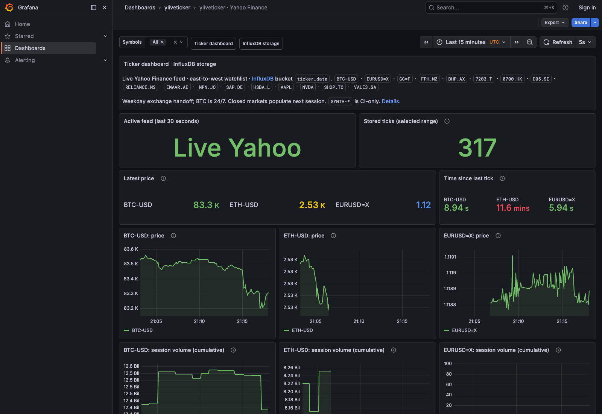

# yliveticker — Yahoo Finance live market-data toolkit

[](https://github.com/yahoofinancelive/yliveticker/actions)
[](https://github.com/yahoofinancelive/yliveticker/actions/workflows/grafana-quickstart.yml)
[](https://pypi.org/project/yliveticker/)
[](https://opensource.org/licenses/MIT)

Stream Yahoo Finance prices into **Python, pandas, time-series databases and
Grafana**, or watch them directly in your terminal. Focused on Yahoo's WebSocket
feed since 2020.

## InfluxDB + Grafana quickstart

With [Docker Desktop or Docker Engine and Compose v2](https://docs.docker.com/compose/install/):

**Before [PR #22](https://github.com/yahoofinancelive/yliveticker/pull/22) merges,
check out `feat/pooling-and-grafana` before running Compose.** The older `main`
Compose file does not start a collector and ignores `TICKER_SYNTHETIC`.

```bash
git clone https://github.com/yahoofinancelive/yliveticker.git
cd yliveticker
docker compose -f docker/docker-compose.yml up --build -d
sh docker/wait-for-stack.sh
```

Open **[Grafana](http://localhost:3000)** — the ticker dashboard is the home page.
It is also listed under **Dashboards → yliveticker**, with a
[direct dashboard link](http://localhost:3000/d/yliveticker-dashboard).
The collector writes to **InfluxDB 2, bucket `ticker_data`**; Grafana reads those
stored ticks through the provisioned InfluxDB datasource.

**The default uses live Yahoo quotes** through the package's real WebSocket
client. Its east-to-west watchlist covers New Zealand (`FPH.NZ`), Australia
(`BHP.AX`), Japan (`7203.T`), Hong Kong (`0700.HK`), Singapore (`D05.SI`), India
(`RELIANCE.NS`), Dubai (`EMAAR.AE`), South Africa (`NPN.JO`), Frankfurt/Xetra
(`SAP.DE`), London (`HSBA.L`), and the Americas (`AAPL`, `NVDA`, `SHOP.TO`,
`VALE3.SA`), plus `BTC-USD`, `EURUSD=X`, and gold futures (`GC=F`). The dashboard
shows the active feed, stored tick count, latest prices, tick freshness, separate
charts and cumulative volume.
The readiness script checks that a recent live tick actually reached InfluxDB
before reporting success. It also works with Compose versions that do not support
`--wait`.

For a deterministic offline/CI check, explicitly enable synthetic data:

```bash
TICKER_SYNTHETIC=1 docker compose -f docker/docker-compose.yml up --build -d
sh docker/wait-for-stack.sh
```

Synthetic test symbols are visibly prefixed `SYNTH-` and never presented as market
quotes. Yahoo's unofficial feed can be unavailable, and closed markets can be
silent; the default crypto symbol normally continues updating outside equity
market hours. Put `TICKER_SYNTHETIC=1` in `docker/.env` only for pipeline testing.



*The default quickstart connects to Yahoo. The exchange sequence gives broad
weekday coverage, while BTC supplies true 24/7 ticks. Closed exchanges begin
populating when their next trading sessions open.*

**[Quickstart settings, synthetic test feed and troubleshooting →](docker/README.md)**

## Choose your workflow

| Goal | Start here |
| --- | --- |
| Live charts without writing Python | [Docker + Grafana](#influxdb--grafana-quickstart) |
| A stock/crypto watchlist in your terminal | [CLI dashboard](#terminal-dashboard) |
| Feed your own application with ticks | [Python callback](#python-callback) |
| Collect DataFrames and aggregate candles | [pandas and OHLCV](#pandas-and-ohlcv) |
| Persist ticks for queries and visualization | [Database sinks](#database-sinks) |

The core client is lightweight and blocking, with automatic reconnection and
WebSocket pings. Large watchlists automatically use a bounded connection pool.
Optional dependencies add the CLI, pandas and database drivers.
The protobuf decoder supports modern Protobuf versions, including 4.x/5.x/7.x.

### Why a dedicated streaming toolkit?

[yfinance](https://github.com/ranaroussi/yfinance) covers a broad range of Yahoo
Finance data and also offers WebSocket clients. Choose `yliveticker` when you
want the focused **tick → storage → visualization** workflow, bundled database
sinks, pandas collection or a terminal watchlist. Its current Python interface
uses callbacks; a native asyncio iterator and runtime subscription changes are
not part of the current API.

## Installation

Python 3.7 or newer is required. Optional drivers may require a newer Python.

```bash
python -m pip install yliveticker

# Terminal dashboard and pandas analysis
python -m pip install 'yliveticker[cli,pandas]'
```

## Terminal dashboard

Watch symbols with live prices, daily changes, sparklines and connection status:

```bash
yliveticker watch AAPL MSFT TSLA BTC-USD

# Also export received ticks to CSV
yliveticker watch AAPL BTC-USD --export my_data.csv
```

## Python callback

```python
import yliveticker


def on_tick(ws, tick):
    print(tick["id"], tick["price"], tick["timestamp"])


# Blocks while streaming; press Ctrl+C to stop.
yliveticker.YLiveTicker(
    on_ticker=on_tick,
    ticker_names=["BTC-USD", "AAPL", "EURUSD=X"],
)
```

Ticks contain `id`, `price`, `timestamp`, `exchange`, `quoteType`, `marketHours`,
`changePercent`, `dayVolume`, `dayHigh`, `dayLow`, `change`, `openPrice` and
`priceHint`. `timestamp` is Yahoo's Unix timestamp in **milliseconds**.
`dayVolume` is cumulative session volume; prices use each symbol's quote currency.
Availability and update frequency vary by instrument and market.

### Large watchlists and pooling

The client removes duplicate symbols, preserves their order, and splits the
watchlist into buckets of **at most 100 symbols per connection**. Up to four
connections (400 unique symbols) are allowed by default. A larger list raises
`ValueError` before connecting; increase `max_connections` explicitly when needed.

Live tests observed Yahoo accepting only the first 100 subscriptions on one
socket, even when later symbols were sent in separate messages. Pooling recovered
updates beyond that boundary. This is a measured behavior of an unofficial feed,
not a published Yahoo limit or an assurance that every symbol will update.

```python
client = yliveticker.YLiveTicker(
    ticker_names=my_watchlist,
    on_ticker=on_tick,
    symbols_per_connection=100,
    max_connections=6,  # Up to 600 unique symbols, if needed.
    start=False,
)
try:
    client.run()  # Blocks; call client.close() from another thread to stop.
finally:
    client.close()
print(client.diagnostics)
```

Each bucket reconnects independently and resubscribes its own symbols. Tick,
error and close callbacks run serially on the thread calling `run()`, preserving
compatibility with existing sinks. `ws` in a tick callback identifies its actual
connection; `client.ws` remains the first connection, and `client.connections`
contains the entire pool. `on_close()` reports individual connection closures
while streaming, so one such event does not mean the whole pool stopped.

A bounded queue (1,000 events by default) applies backpressure when callbacks
are slow. `diagnostics` reports per-connection state, received counts, reconnects,
last receive time, queue depth and backpressure events. Keep callbacks quick:
pooling does not solve a slow sink or provide durable replay. `close()` stops all
sockets; `run()` drains queued events during normal shutdown. Frames arriving
after shutdown starts can be discarded and are counted. Ctrl+C or a callback
exception that escapes the error handler can interrupt draining. A client can
be run only once; create a new client to restart or change subscriptions.

The CLI uses the same pool. Override its bounds with
`--symbols-per-connection 100 --max-connections 6` when necessary.

## pandas and OHLCV

Install `yliveticker[pandas]`, then collect ticks and inspect them after stopping:

```python
import yliveticker
from yliveticker import YTimeSeries

series = YTimeSeries()
try:
    yliveticker.YLiveTicker(
        on_ticker=series.on_ticker,
        ticker_names=["BTC-USD"],
    )
except KeyboardInterrupt:
    pass

print(series.get_dataframe().head())
for symbol, candles in series.get_ohlcv(interval="1min").items():
    print(symbol, candles)
```

The current OHLCV `volume` column is the last observed cumulative `dayVolume`
in each interval, **not interval traded volume**. The Grafana dashboard labels
that same value as cumulative session volume.

## Database sinks

| Database | Install extra | Sink class |
| --- | --- | --- |
| InfluxDB 2 | `yliveticker[influxdb]` | `InfluxDBSink` |
| TimescaleDB | `yliveticker[timescaledb]` | `TimescaleDBSink` |
| ClickHouse | `yliveticker[clickhouse]` | `ClickHouseSink` |
| QuestDB | `yliveticker[questdb]` | `QuestDBSink` |
| Amazon Timestream | `yliveticker[timestream]` | `TimestreamSink` |

Install only the drivers you need, or use `python -m pip install 'yliveticker[all]'`.
For the bundled InfluxDB/Grafana setup, the Docker collector installs the
InfluxDB extra automatically.

To run the collector on your host for development, from the repository root:

```bash
docker compose -f docker/docker-compose.yml up -d influxdb grafana
python -m pip install -e '.[influxdb]'
python examples/tsdb_example.py BTC-USD AAPL
```

Stop any existing Docker collector first to avoid duplicate writers. The
[example](examples/tsdb_example.py) accepts symbols, environment-based InfluxDB
settings and `--synthetic`, waits for database readiness and flushes on shutdown.
See the [quickstart guide](docker/README.md) for credentials and lifecycle commands.

Sinks batch writes in memory. Failed batches are logged, without durable replay;
use an appropriate durable pipeline if your application requires lossless ingestion.

## Client configuration

| Parameter | Default | Description |
| --- | --- | --- |
| `on_ticker` | `None` | Callback `f(ws, tick)` for each update; otherwise prints JSON. |
| `ticker_names` | `["AMZN"]` | Yahoo symbols; deduplicated and assigned to connection buckets. |
| `on_error` | `None` | Optional callback `f(error)`. |
| `on_close` | `None` | Optional callback `f()` for a connection closure while streaming. |
| `reconnect` | `5` | Per-connection retry delay in seconds; `0` disables retries. |
| `ping_interval` | `15` | WebSocket ping interval in seconds. |
| `ping_timeout` | `10` | Seconds to wait for a pong. |
| `enable_socket_trace` | `False` | Enable raw WebSocket frame logging. |
| `symbols_per_connection` | `100` | Bucket size, from 1 to 100 unique symbols. |
| `max_connections` | `4` | Maximum sockets; exceeding capacity raises `ValueError`. |
| `queue_size` | `1000` | Maximum pending callback events; must be positive. |
| `start` | `True` | Stream in the constructor; set `False` and call `run()` to start later. |

## Data availability

Yahoo's WebSocket endpoint is unofficial. Updates can be delayed, interrupted
or absent while a market is closed. A successful synthetic quickstart check
verifies the local pipeline; it does not verify Yahoo's live feed. Check Yahoo's
applicable terms and data entitlements for your intended use.

## Contributing and license

Bug reports, examples of downstream usage and contributions are welcome. See
[CONTRIBUTING.md](CONTRIBUTING.md). Distributed under the [MIT License](LICENSE).
